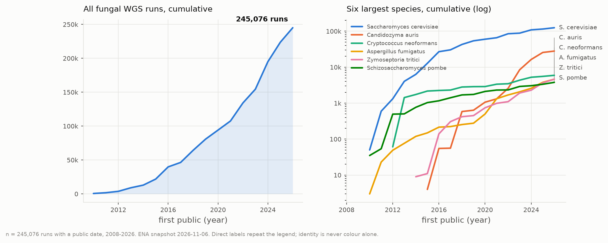
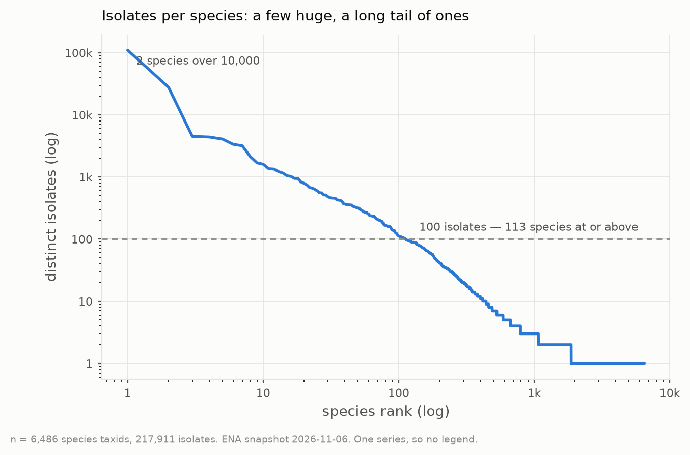
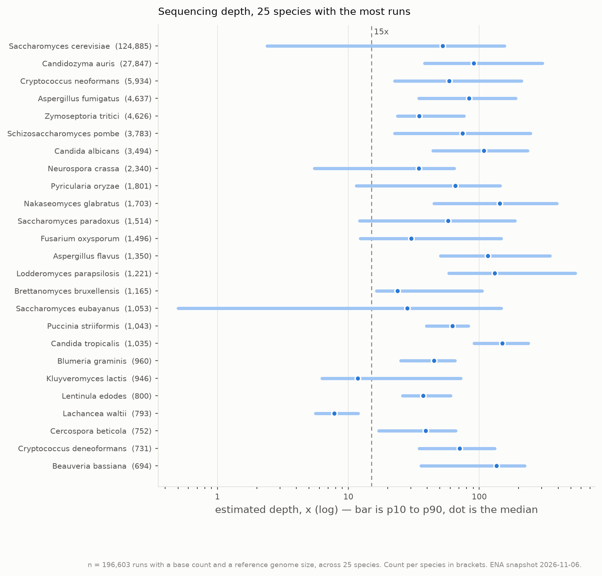
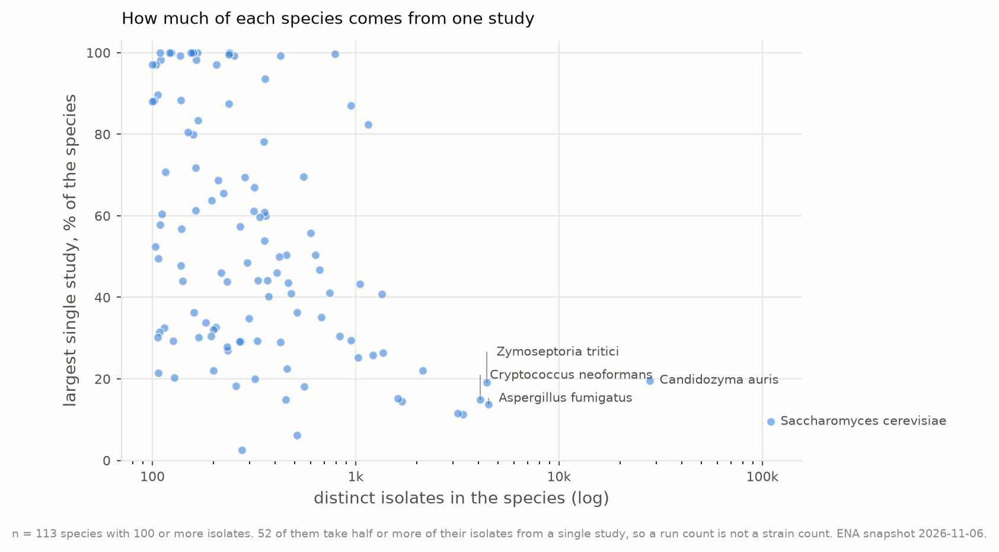
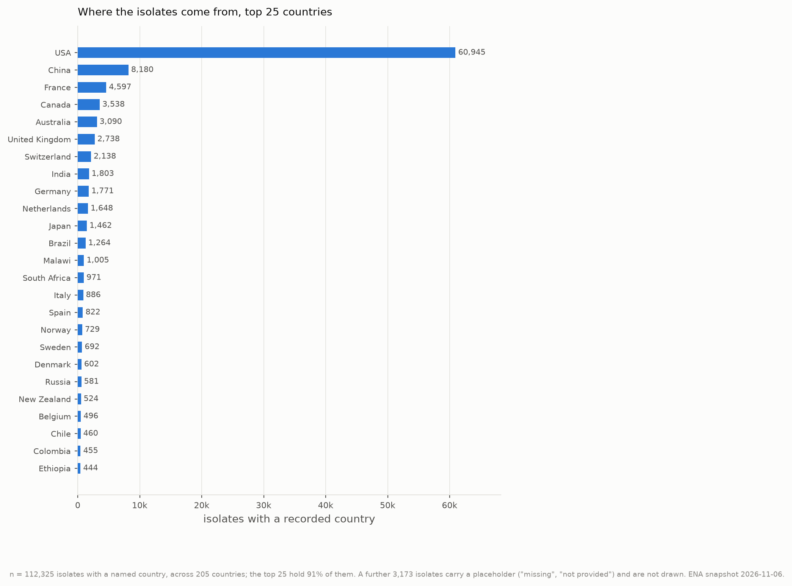

# What is in the archive

Figures over the fungal population-sequencing catalog. Generated by
`scripts/popseq_figures.py` and `scripts/popseq_report.py` from the tables in
`catalog/summary/` and `catalog/kingdom/`. Source snapshot: ENA 2026-11-06.

Each figure ships three files: a light PNG, a dark PNG, and a vector PDF for
print and slides. The page below picks the PNG that matches your theme. Every
number on this page is computed from the tables at generation time.

**One caveat that applies to every figure.** These are *public whole-genome
Illumina runs of fungal isolates*, as the two archives describe them. A run count
is not a strain count, an isolate count is not an independent-sample count, and
every count here is a floor: ENA holds runs with an empty `tax_id` that no
taxonomy query reaches (issue #2).

## At a glance

| | |
|---|---|
| Runs | 245,076 |
| Distinct isolates | 217,911 |
| Species taxids | 6,486 |
| Species with 100+ isolates | 113 |
| Species with a single isolate | 4,615 |
| Estimated size, one run per isolate | 136 TB |

---

## 1. The archive is young and still accelerating

<picture>
  <source media="(prefers-color-scheme: dark)" srcset="01_cumulative_runs.dark.png">
  
</picture>

**Left:** every fungal WGS run, cumulated by the year it became public. **Right:** the six largest species on a log scale, which is the only way they fit on one axis. 90,625 runs — 37% of the archive — became public in 2024 or later. &nbsp;·&nbsp; [PDF](01_cumulative_runs.pdf) &nbsp;·&nbsp; [light PNG](01_cumulative_runs.light.png) &nbsp;·&nbsp; [dark PNG](01_cumulative_runs.dark.png)


The kingdom curve has no plateau. Anything built on this catalog needs to be
regenerable rather than a one-time snapshot, because the snapshot is stale within
months.

---

## 2. A few huge species, and a very long tail

<picture>
  <source media="(prefers-color-scheme: dark)" srcset="02_isolates_rank.dark.png">
  
</picture>

Isolates per species against species rank, both axes log. 2 species hold more than 10,000 isolates; 6,373 of 6,486 hold fewer than 100, and 4,615 hold exactly one. &nbsp;·&nbsp; [PDF](02_isolates_rank.pdf) &nbsp;·&nbsp; [light PNG](02_isolates_rank.light.png) &nbsp;·&nbsp; [dark PNG](02_isolates_rank.dark.png)


This shape is why the catalog has a depth-tier policy. Downloading everything for
the head of this curve is tens of terabytes for two species, while the tail is
mostly single genomes that are not a population at all. 113 species have
100 or more isolates, and those are the ones worth a population analysis.

---

## 3. Depth is usually sufficient, and sometimes is not

<picture>
  <source media="(prefers-color-scheme: dark)" srcset="03_coverage.dark.png">
  
</picture>

Estimated depth for the 25 species with the most runs. Bar is p10 to p90, dot is the median. Depth is `base_count` over the NCBI reference assembly size, so it is an estimate, not a measurement on the reads. 178,554 of 219,217 runs (81%) clear 15x. &nbsp;·&nbsp; [PDF](03_coverage.pdf) &nbsp;·&nbsp; [light PNG](03_coverage.light.png) &nbsp;·&nbsp; [dark PNG](03_coverage.dark.png)


Most species sit well above 15x at the median, but the p10 end crosses the line
for several. Depth has to be filtered per run, not assumed per species. The
species with an estimate at all are limited by whether a reference assembly size
could be resolved: 109 of 6,486 species.

---

## 4. A run count is not a strain count

<picture>
  <source media="(prefers-color-scheme: dark)" srcset="04_clonality.dark.png">
  
</picture>

For each species with 100 or more isolates, the share of its isolates that come from its single largest study. 52 of 113 species take half or more of their isolates from one study. &nbsp;·&nbsp; [PDF](04_clonality.pdf) &nbsp;·&nbsp; [light PNG](04_clonality.light.png) &nbsp;·&nbsp; [dark PNG](04_clonality.dark.png)


A species whose isolates come from one outbreak study is one clonal cluster
sampled many times, not a diverse population. For a question about standing
variation this is the difference between a usable panel and a misleading one. The
catalog records studies per species so this can be filtered before download, not
discovered afterwards.

---

## 5. Where the isolates come from

<picture>
  <source media="(prefers-color-scheme: dark)" srcset="05_geography.dark.png">
  
</picture>

Top 25 countries by isolates with a recorded country. 112,325 isolates across 205 countries carry a country name; a further 3,173 carry a placeholder string and are not drawn. USA alone accounts for 54%. &nbsp;·&nbsp; [PDF](05_geography.pdf) &nbsp;·&nbsp; [light PNG](05_geography.light.png) &nbsp;·&nbsp; [dark PNG](05_geography.dark.png)


Sampling is heavily concentrated. Roughly
149 of the 205 countries
present contribute fewer than 100 isolates each. Any statement about global
diversity from this archive is a statement about where people sequence.

A choropleth map was not produced. The plotting environment has no geographic
library, and adding one pulls in a heavy dependency chain plus a world-boundary
file that would have to be downloaded and vendored. The bar chart carries the same
information without that cost. Say the word and the map gets built.

---

## Regenerating this page

```bash
uv run --extra viz python scripts/popseq_figures.py   # 15 files into figures/
uv run python scripts/popseq_report.py                # this page
```

Both read only committed catalog tables. Neither touches the network.

Colours are the validated default categorical palette, checked against the
colourblind-separation and contrast gates for both the light and the dark surface
on 2026-11-06. Light and dark are two renders with the palette stepped for each
surface, not an inversion. Where a series colour falls below 3:1 on the light
surface, the series also carries a direct text label, so identity never rests on
colour alone.
